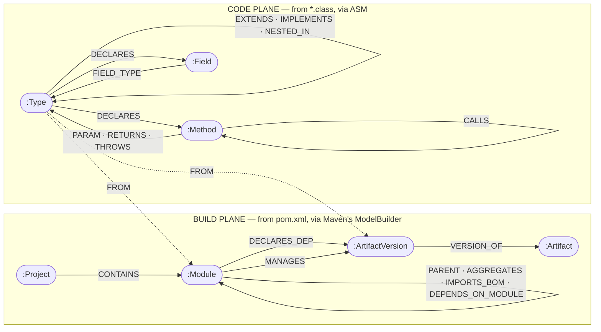
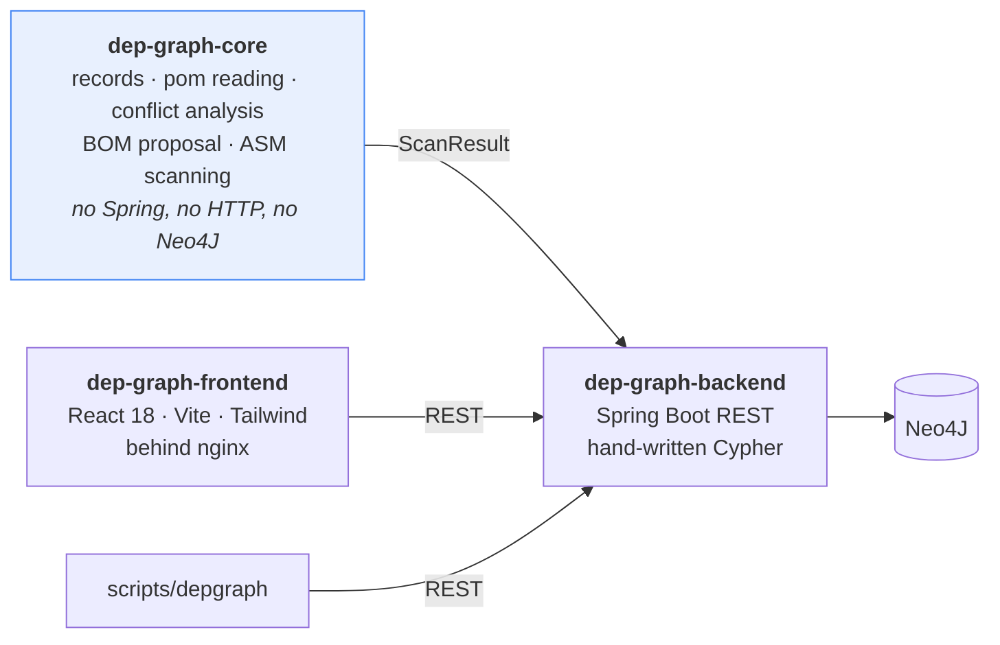
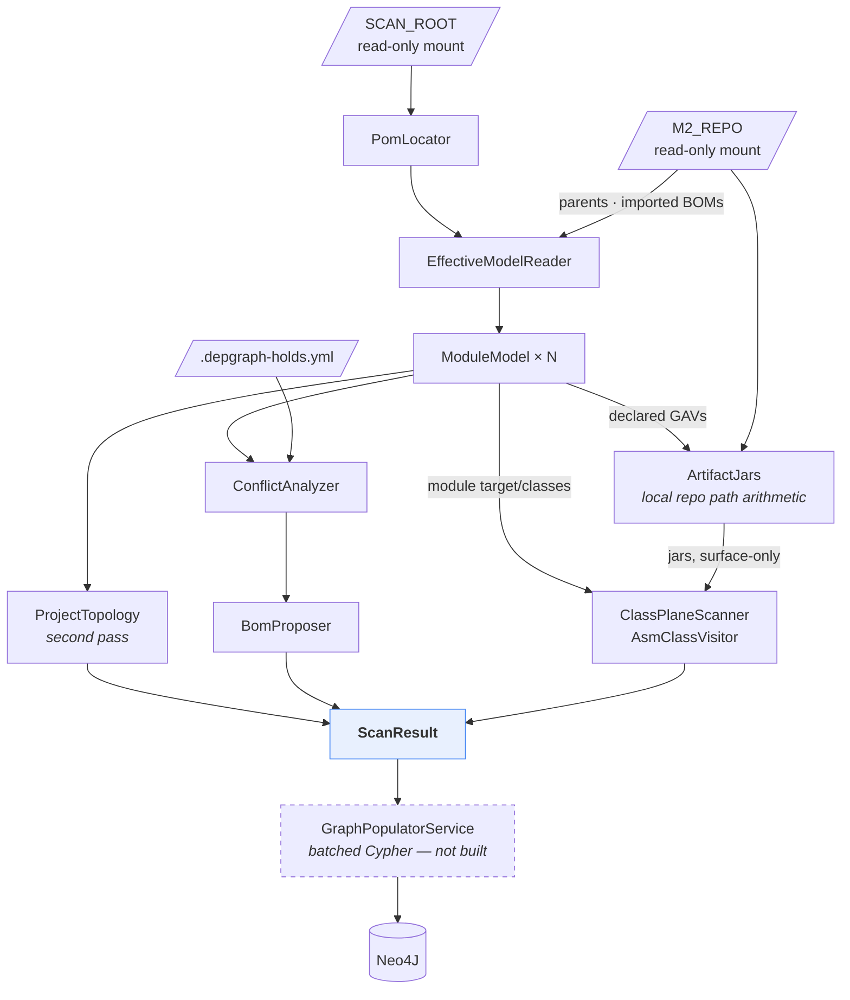
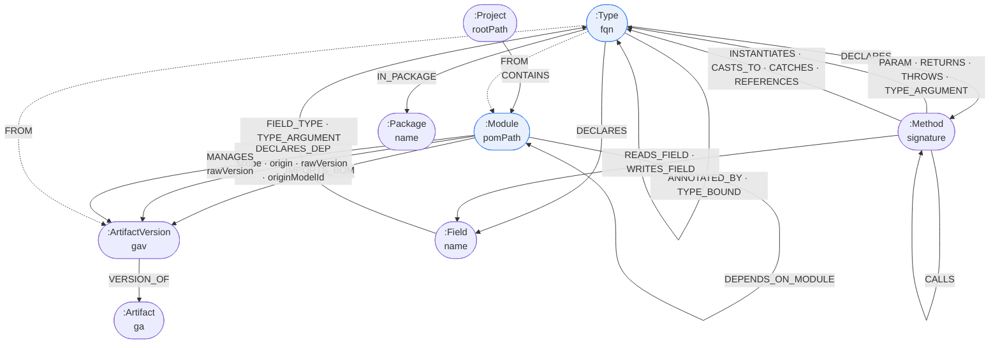
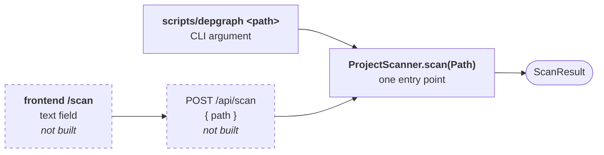
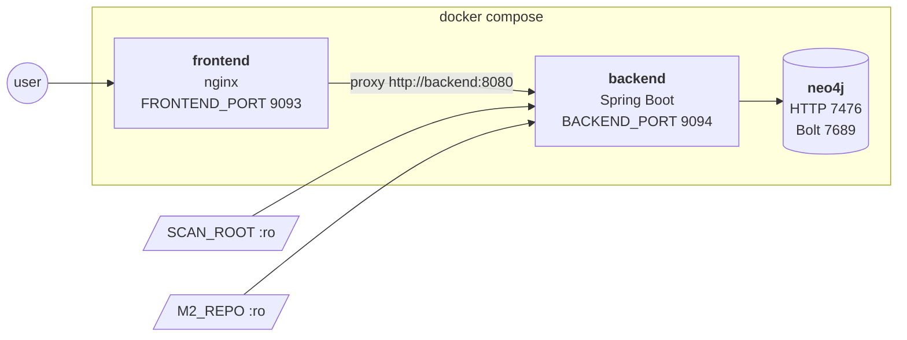
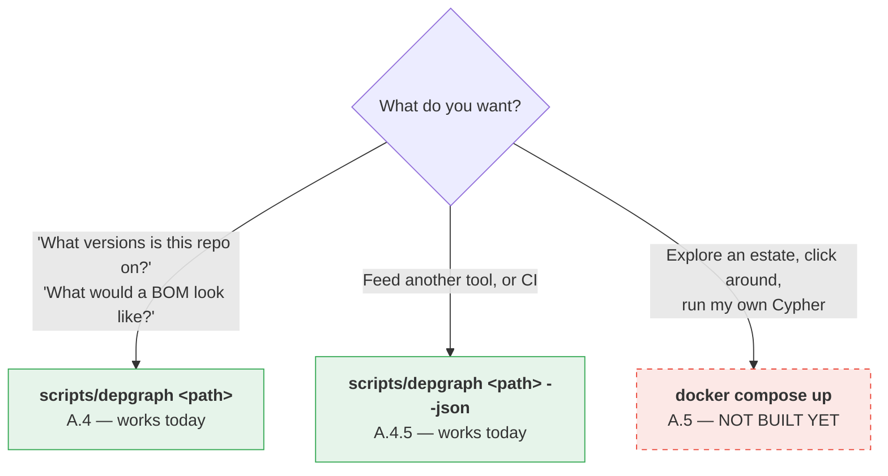
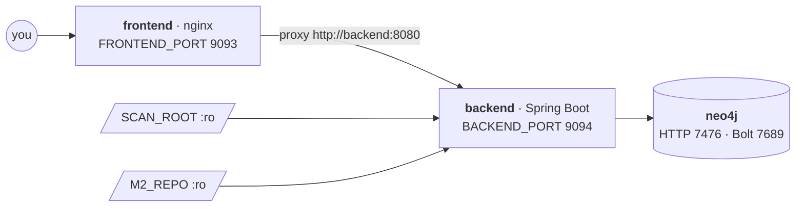

# dep-graph — Architectural Overview

- **Date:** 2026-09-19
- **Repository:** `aero/dependencies` — the eighth slot in the Aero estate
- **Status:** both analysis planes and the CLI built and dogfooded; backend and frontend
  not yet written

---

## 1. Executive summary

`dep-graph` answers two questions about a multi-module Java project that nothing in the
estate can answer today:

1. **What version of anything are we actually on** — and where did that number come from?
2. **Does the code actually use what the build declares** — and does it use anything the
   build never declared?

It answers the first by reading every pom through Maven's own model builder, so the
version it reports is the one javac will see rather than the text the file happens to
show. It answers the second by reading compiled bytecode with ASM and joining the two
results in one Neo4J graph.

The join is the point. Dependency-analysis tools are plentiful and nearly all of them work
on one plane only: `mvn dependency:analyze` sees the build and guesses at the code,
architecture linters see the code and know nothing of the build. One graph containing both,
with an edge from each type to the artifact it came from, turns three expensive questions
into traversals: *which declared dependencies are dead weight*, *which classes are living
on somebody else's transitive*, and *what is the blast radius of retiring this library*.

**Where it stands.** `dep-graph-core` is complete for **both planes** and has a working
CLI, with 46 tests.
The build plane does pom discovery, effective-model resolution, version-origin
attribution, project topology, conflict classification, BOM proposal and version holds.
The code plane reads bytecode with ASM and captures all seventeen class relations.

Against the real Aero estate: 33 poms, 146 dependencies, 68 artifacts and 48 topology
edges on the build plane; **33,211 classes into 192,441 edges in 4.6 seconds** on the code
plane. Between them the runs found four genuine version conflicts, corrected a standing
claim in the estate's own architecture review, measured the size of the code plane's
largest blind spot (15,377 inlined constants), and changed one design decision.

`scripts/depgraph` runs the whole analysis on any Maven project — single-module or
multi-module — with nothing but a JDK. The Neo4J backend and the React frontend are not
built.

**What needs review.** The two relationship taxonomies (§4.6 and §5.2), the graph shape
(§6), where the CLI lives (§7.1), and the six open decisions in §9.3.

---

## 2. Problem statement

### 2.1 A version is not a property of a dependency

This is the idea the whole tool is built on, and it is why "just parse the XML" does not
work.

In any multi-module project worth analysing, most `<dependency>` elements carry no
`<version>` at all, and most of the ones that do say `${something.version}`. That property
may be defined three poms up, redefined in a child, overridden by a profile, or shadowed
entirely by an imported BOM. The version a build actually uses is the **outcome of an
argument** between the module, its parents and every BOM they import.

The fixture estate makes the failure concrete. Two modules both declare:

```xml
<dependency>
    <groupId>com.google.guava</groupId>
    <artifactId>guava</artifactId>
    <version>${guava.version}</version>
</dependency>
```

They resolve to `32.1.3-jre` and `32.1.2-jre`, because one of them redefines the property
locally. A tool that reads the text reports two identical declarations and finds no
conflict at all. Every conflict table built that way is fiction.

### 2.2 Who won matters as much as what won

Knowing a module is on jackson `2.17.1` is half an answer. The other half is whether the
module *chose* it or whether Spring Boot chose it for them, because the two want opposite
treatment:

- A module that names `2.17.1` has made a decision someone can be asked about, and
  changing it will be noticed in that file.
- A module that says nothing and inherits `2.17.1` from `spring-boot-dependencies` has
  made no decision at all. Pinning that version into a new BOM does not unify anything —
  it creates a second opinion that silently wins, and the next Boot upgrade moves one of
  them and not the other.

That second case is how an estate drifts apart one upgrade at a time, and a BOM-extraction
tool that cannot tell the two apart actively causes the problem it was built to solve.

### 2.3 A dependency is one of four ways poms are wired together

`<dependency>` is the edge everyone thinks of and rarely the one that decides anything.
Inheritance decides settings, aggregation decides what builds together, and BOM imports
decide versions. A graph carrying only dependencies can list what a project uses but
cannot draw its shape, and cannot explain a single version it reports.

### 2.4 The build plane and the code plane never meet

Separately, both halves are blind:

| Question | Build plane alone | Code plane alone |
|---|---|---|
| Does this module need Guava? | It declares it | Some class calls `ImmutableList.of` |
| Is this dependency dead? | Cannot say | Cannot see declarations |
| Is this class on an undeclared transitive? | Cannot say | Cannot see declarations |
| What breaks if we drop this library? | Every module that declares it | Every class that imports it |

Neither column answers the middle two rows. Both are routine questions in an estate that
is trying to consolidate.

### 2.5 The estate's own evidence

The Aero estate was, until recently, seven repositories with four groupIds, three Spring
Boot versions and roughly twenty hand-pinned library versions each. `aero-bom` fixed most
of that by hand, over a session, by reading poms. This tool is that work, mechanised —
and pointed at itself it still found two modules hand-pinning versions over BOMs that
already manage them (§8.2).

---

## 3. Architectural overview

### 3.1 Two planes, one graph, one bridge



Everything interesting lives on the dashed bridge edge.
`(:Type)-[:FROM]->(:Module|:ArtifactVersion)` is what lets one query say "this module
declares Guava and no type in it has a `FROM` edge to Guava", and another say "this type
references a class whose artifact the module never declared".

Two further shape decisions:

- **`:Artifact` is split from `:ArtifactVersion`.** The version-free node is what a BOM
  has an opinion about, so "every version of jackson-databind in this estate and who wants
  it" is one hop out and back. Keying everything on GAV would make that a string search.
- **A materialised `DEPENDS_ON {weight, kinds}` rollup** is computed post-ingest, because
  both the metrics and the UI want the collapsed view and neither wants to pay for the
  expansion on every query. The weight comes from the relation taxonomy in §5.

### 3.2 Module topology

Follows the estate's core/backend/frontend house style rather than a finer-grained split.



| Module | Contains | Knows about |
|---|---|---|
| `dep-graph-core` | Records, pom reading, topology, conflict analysis, BOM proposal, ASM scanning | Nothing. No Spring, no HTTP, no Neo4J |
| `dep-graph-backend` | Spring Boot REST API, Cypher writes, pre-canned queries | `dep-graph-core`, Neo4J, HTTP |
| `dep-graph-frontend` | React 18 + Vite + Tailwind behind nginx | The REST API only. Not a Maven module |

The line between core and backend is a single record. Core produces a `ScanResult` and
knows nothing of what happens next; the backend consumes one and knows nothing of how it
was made. That is deliberately the same seam `svc-discovery` and `msg-discovery` use, so
that a future `discovery-common` extraction is a move rather than a rewrite.

### 3.3 Data flow



`ProjectScanner` composes the two, and the order is not optional: the code plane needs the
build plane's answer twice over — which directories are modules, and which jars the
declared dependencies resolve to. Reading bytecode first would mean scanning whatever
happened to be on disk with no way to attribute any of it, and attribution is the entire
point of the `FROM` bridge.

`ProjectTopology` is a **second pass on purpose**: a module cannot be told apart from a
third-party artifact until every pom in the scan has been read.

One scan wipes and reloads. There is no history — a settled decision, on the grounds that
"what does this project depend on today" is the question people ask, and a temporal graph
makes every query harder in order to answer a question nobody asked.

### 3.4 Why bytecode rather than source — the one estate divergence

The rest of the estate parses `.java` with JavaParser, and both discovery scanners hold a
settled rule: **a detection must be decidable from a single parse — no type resolution, no
second pass.** That rule is what keeps a monorepo scan finishable.

It does not transfer here, because the code plane *is* type resolution. JavaParser without
its symbol solver reads a return type of `List<Order>` as exactly that text and cannot say
whether `Order` is `com.acme.billing.Order` or `com.acme.catalog.Order` — and an edge to
the wrong class is worse than no edge. Turning the symbol solver on buys the answer at the
price of the classpath configuration and the repeated passes the scanners banned.

ASM sidesteps the argument rather than winning it. javac already did the resolution; the
fully qualified name sits in the constant pool, generics survive in the `Signature`
attribute, and the "third-party public surface only" rule is an `ACC_PUBLIC | ACC_PROTECTED`
mask rather than a traversal. Roughly 10k classes/sec.

**It costs exactly one thing, and the tool states it plainly:** the scan target must
already be compiled. A module with no `target/classes` is reported by name rather than
silently contributing nothing. §5.3 lists the four things bytecode cannot see at all.

---

## 4. Nuts and bolts — the build plane

### 4.1 Pipeline

| Stage | Class | Responsibility |
|---|---|---|
| 1 | `PomLocator` | Walk the tree for `pom.xml`, skipping `target`, `node_modules`, dotfiles |
| 2 | `EffectiveModelReader` | Build each pom's effective model; attribute every version; capture its own `dependencyManagement` |
| 3 | `ProjectTopology` | Second pass — resolve parent, aggregation, BOM import and module edges |
| 4 | `HoldsFile` | Read `.depgraph-holds.yml` from the scan root |
| 5 | `ConflictAnalyzer` | Collapse dependencies onto `:Artifact`; classify the skew |
| 6 | `BomProposer` | Decide the `<dependencyManagement>` block that would fix it |
| 7 | `BomXmlWriter` | Render that block as XML someone can paste |
| — | `BuildPlaneScanner` | Orchestrates 1–6 into a `ScanResult` |

`BomXmlWriter` stops deliberately at printing. Rewriting poms in place is the OpenRewrite
step (§9.3), and the local cautionary tale — a tool in this estate that writes in place
with no dry-run and is not idempotent — is exactly why the printing and the writing are
separate pieces of work.

`PomLocator` skipping `target/` is not housekeeping. A build copies poms into
`target/classes` and into unpacked dependencies; counting those reports the same module
several times at several versions, which is a *fabricated* conflict — the worst output
this tool could produce.

### 4.2 Version-origin attribution

The technique the build plane rests on:

```java
request.setLocationTracking(true);
...
InputLocation location = dependency.getLocation("version");
String decidedBy = location.getSource().getModelId();
```

`decidedBy` names the pom or BOM that supplied the version. Compared against
`result.getModelIds()` — the module's lineage — it yields:

| `VersionOrigin` | Condition | Meaning |
|---|---|---|
| `LOCAL_DECLARATION` | raw pom has a `<version>` | The module chose it, literally or via a property |
| `LOCAL_MANAGEMENT` | `decidedBy` == own model id | This pom's own `dependencyManagement` |
| `INHERITED_MANAGEMENT` | `decidedBy` in lineage | A parent decided it |
| `IMPORTED_BOM` | `decidedBy` **not** in lineage | An imported BOM decided it — named exactly |
| `UNKNOWN` | no location | Unattributable |

Because the id is exact, a report can say *"`com.fasterxml.jackson:jackson-bom:2.21.4`
already manages this"* rather than "managed elsewhere". That precision is what makes §4.5
actionable.

`RepositoryModelResolver` supplies the parents and BOMs the builder asks for, backed by
maven-resolver. Deliberately not Maven's own `ProjectModelResolver`, which lives in
`maven-core` and drags in a Sisu container, a plugin manager and a lifecycle executor —
none of them wanted by a tool whose entire relationship with Maven is reading files.

### 4.3 Declared versus managed

`ManagedDependency` is captured separately from `DeclaredDependency`, and from the **raw**
model rather than the effective one.

The effective `dependencyManagement` of anything importing `spring-boot-dependencies` is
about 2,500 entries, none of which anybody wrote. Recording those would bury the handful a
pom actually decided under Spring Boot's entire catalogue. What the pom's own block says
is both much shorter and the only version of it that exists in a file a human can edit.

Managing an artifact is also not depending on it — a BOM declares hundreds and needs none
at build time — which is why it is a separate record rather than a flag.

### 4.4 Conflict severity

| Severity | Definition | In the proposal? |
|---|---|---|
| `UNIFORM` | One version everywhere | Only if some module hand-pins it |
| `SAFE` | Patch skew (`2.15.2` / `2.15.4`) | Yes, at the highest in use |
| `REVIEW` | Minor skew (`2.15.4` / `2.17.0`) | Yes, flagged |
| `BLOCKED` | Major skew (`3.3.1` / `4.0.11`) | **No** — that is an API migration |
| `ALREADY_MANAGED` | An imported BOM owns it | **No** — align the import instead |

Ordering uses Maven's `ComparableVersion`, not string comparison or dot-splitting:
`String.compareTo` puts `1.10` before `1.9`, and int-parsing falls over on
`6.7.0.202309050840-r`, which is a real version of a library this estate depends on. A
version that does not begin with a number is classified `REVIEW`, never `SAFE` — the
severities only earn their keep if "safe" means nobody has to read the row.

### 4.5 Deliberate holds

`.depgraph-holds.yml` at the scan root records a version the project stays on **on
purpose**:

```yaml
holds:
  - artifact: org.apache.pulsar:pulsar-client
    version: 3.3.1
    reason: >-
      4.x changes the schema and subscription APIs. This is an API migration rather
      than a bump, so it gets scheduled rather than inherited.
    until: when the messaging layer moves off the 3.x subscription API
```

A held artifact is proposed at the held version and stops being reported as something to
fix — including when the skew is `BLOCKED`, because the hold *is* the decision a `BLOCKED`
row is asking someone to make.

A hold with no `reason` is ignored on purpose. An unexplained hold is indistinguishable
from neglect, which is the thing holds exist to be distinguished from.

This requirement was discovered by planning to dogfood on the estate: `aero-bom` holds
`opentelemetry-bom` at 1.54.1 against Boot's 1.49.0, and `pulsar-client` at 3.3.1 against
Boot's 4.0.11, both with written rationale. Without holds the tool nags forever about
decisions already made.

### 4.6 Pom relationship taxonomy — `ModuleRelation`

Four edges. Only one is a dependency.

| Relation | Source | Target may be outside the scan? | Why it is separate |
|---|---|---|---|
| `PARENT` | `<parent>` | **Yes, usually** | Where inheritance, and so most managed versions, comes from |
| `AGGREGATES` | `<modules>` | No | Says what builds together, *not* what decides settings. Routinely confused with `PARENT`; a pom can do either, both or neither |
| `IMPORTS_BOM` | `<dependencyManagement>` with `scope=import` | Yes | The single most important edge for explaining a version |
| `DEPENDS_ON_MODULE` | `<dependency>` resolving to a module in the same scan | No, by definition | Turns a pile of poms into a topology |

Two properties of this taxonomy are worth stating explicitly, because both surprised the
first implementation:

**Most parents are external.** Every repository in this estate inherits `aero-parent`,
which is resolved from the artifact repository and has no pom on disk. The edge therefore
carries a GAV always and a path only sometimes. A null path is a *fact about the project*,
not a failure to resolve, and the graph says so.

**`DEPENDS_ON_MODULE` is derived, not declared.** Nothing in a pom says "this dependency
is one of us". The answer changes with the scan root: scan one repository and its siblings
are third-party artifacts; scan the estate and they are modules. This is the only relation
in either taxonomy whose truth depends on where you pointed the tool.

### 4.7 Testing

46 tests in total — 18 on the build plane, 15 on the code plane, 13 on the CLI.

The build-plane tests run against `src/test/resources/sample-estate/`, a five-pom fixture carrying one of
each problem deliberately: a patch conflict, a minor conflict, a major conflict, an
artifact hand-pinned over an imported BOM, an artifact cleanly owned by that BOM, a
property redefined in a child, a held artifact, an intra-project module dependency, and an
aggregator that is also a parent.

A second fixture, `src/test/resources/simple-project/`, is a **single pom with no parent
and no modules** — the shape most repositories actually are. It exists because "works on a
multi-module estate" and "works on any Maven project" are different claims, and only one of
them was tested until the CLI made the difference matter.

The imported BOM is a hand-written pom under `src/test/resources/fixture-repo/`, resolved
offline from there. Using a real BOM would mean the test only passed on a machine whose
`~/.m2` happened to hold it and the forty BOMs it imports in turn — the assertions would
be claims about the machine rather than about the scanner.

---

## 5. Nuts and bolts — the code plane

### 5.1 Pipeline and settled decisions

| Stage | Class | Responsibility |
|---|---|---|
| 1 | `ArtifactJars` | Locate each declared dependency's jar by path arithmetic — no resolution, no network |
| 2 | `ClassPlaneScanner` | Walk module `target/classes` in full; walk jars surface-only |
| 3 | `AsmClassVisitor` | One class file to edges — the taxonomy below |
| 4 | `TypeSink` | Aggregate occurrences into distinct edges as they arrive |
| — | `ProjectScanner` | Compose both planes into one `ScanResult` |

`TypeSink` aggregates during the walk rather than in a post-pass because a single large
method can emit thousands of identical `CALLS` occurrences, and holding them all to group
them later is the difference between a scan that fits in memory and one that does not.

| Decision | Choice |
|---|---|
| Third-party depth | Public/protected surface only — not opaque GAVs, not full depth |
| Detail level | Signatures **and** call graph (`CALLS`, `INSTANTIATES` included) |
| Generics | Read from the `Signature` attribute, so `List<Order>` keeps `Order` |
| Compilation | Required. Modules lacking `target/classes` are reported by name |
| Artifact bytecode | Read from the read-only `/m2` mount, by path arithmetic |
| JDK types | Excluded. Every class depends on `Object`, `String` and `List`; true, useless, and it roughly doubles the graph |
| Synthetic and bridge members | Skipped. javac generates them for covariant overrides, lambdas and enum switch maps; their descriptors name types the author never wrote |
| Self-edges | Dropped. A class refers to itself constantly and none of it is a dependency |

### 5.2 Class relationship taxonomy — `TypeRelation`

Grouped into three tiers, because "B depends on A" covers situations a mile apart. If B
extends A, B cannot exist without A. If B's method calls one static helper on A, deleting
that call is an afternoon. Each relation carries a weight, and the materialised
`DEPENDS_ON` rollup sums them.

| Tier | Relation | Wt | What it is |
|---|---|---:|---|
| **1 · STRUCTURE** — *B cannot exist without A* | `EXTENDS` | 10 | B is a child of A |
| | `IMPLEMENTS` | 9 | B implements A |
| | `NESTED_IN` | 8 | B is declared inside A |
| | `PERMITS` | 8 | sealed A permits B |
| | `TYPE_BOUND` | 6 | `class B<T extends A>` |
| | `ANNOTATED_BY` | 4 | `@A` on B |
| **2 · SIGNATURE** — *A is in B's API surface* | `FIELD_TYPE` | 7 | B has a field of type A |
| | `PARAM` | 6 | a method **or constructor** of B takes an A |
| | `RETURNS` | 6 | a method of B returns an A |
| | `TYPE_ARGUMENT` | 5 | `List<A>` in B's signature |
| | `THROWS` | 3 | B declares `throws A` |
| **3 · BODY** — *A is used inside a method* | `INSTANTIATES` | 5 | `new A()` |
| | `WRITES_FIELD` | 4 | B writes a field of A |
| | `CALLS` | 3 | B invokes `A.m()` |
| | `READS_FIELD` | 3 | B reads a non-constant field of A |
| | `CASTS_TO` | 2 | `(A) x`, `x instanceof A` |
| | `CATCHES` | 2 | `catch (A e)` |
| | `REFERENCES` | 1 | `A.class`, a method reference, an `ldc` |

The weights are what the materialised `DEPENDS_ON` rollup sums, so a single `EXTENDS`
outranks three `CALLS`. They are a ranking device, not a measurement — their only job is
to stop "B depends on A" from meaning the same thing for an inheritance and for one
static helper call.

The user-facing rule the tiers encode: **for a type from a jar, structure and signature
relations are recorded and body relations are not.** Nobody is refactoring inside a
dependency, and that one line is the whole implementation of "third-party public surface
only".

Two notes on the taxonomy itself:

- **Constructors are not distinguished from methods.** In bytecode a constructor is a
  method named `<init>`, and the coupling a parameter creates is identical either way. The
  `:Method` node keeps the name for anyone who cares.
- **`TYPE_ARGUMENT` is separate from `PARAM` and `RETURNS`** because it is the relation
  most likely to be *missing* — it survives only where javac wrote a `Signature`
  attribute. Recording it distinctly lets a query ask how much of the graph rests on
  erasure.

Where each relation comes from:

| ASM callback | Relations |
|---|---|
| `visit(superName, interfaces)` | `EXTENDS`, `IMPLEMENTS` |
| `visitPermittedSubclass` | `PERMITS` |
| `visitInnerClass` | `NESTED_IN` — emitted from the inner side only, or every nesting is recorded twice and once backwards |
| `visitAnnotation` (class, field, method) | `ANNOTATED_BY` |
| `Signature` attribute, via `SignatureReader` | `TYPE_BOUND`, `TYPE_ARGUMENT` |
| `visitField` | `FIELD_TYPE` |
| `visitMethod` descriptor | `PARAM`, `RETURNS` |
| `visitMethod` exceptions | `THROWS` |
| `visitTypeInsn` | `INSTANTIATES` (NEW), `CASTS_TO` (CHECKCAST, INSTANCEOF) |
| `visitMethodInsn` | `CALLS` |
| `visitFieldInsn` | `READS_FIELD`, `WRITES_FIELD` |
| `visitTryCatchBlock` | `CATCHES` |
| `visitLdcInsn`, `visitInvokeDynamicInsn` | `REFERENCES`, and `CALLS` for method references |

Two details that are easy to get wrong and were: `new Foo()` compiles to `NEW` plus an
`invokespecial <init>`, so the constructor call is deliberately **not** also counted as a
`CALLS` — otherwise every instantiation scores twice. And a lambda or method reference
arrives as an `invokedynamic` whose real target is buried in the bootstrap arguments;
without reading those, every lambda body is invisible.

### 5.3 What bytecode cannot see

Stated here rather than discovered later. Each is a silent hole, and one of them matters a
great deal in this estate.

| Blind spot | Consequence |
|---|---|
| **Inlined compile-time constants.** `static final int MAX = 10` is copied into the caller by javac and leaves no reference to the declaring class | A module whose only use of another is a constant **looks unused** — the exact inverse of what the `constants` repository exists to catalogue, and the one question that genuinely needs a source parse |
| **`SOURCE`-retention annotations.** Lombok's `@Data`, `@Slf4j` | Gone before the class file exists. `CLASS` and `RUNTIME` retention survive as `ANNOTATED_BY` |
| **Generics outside a `Signature` attribute** | Descriptors are erased. Written for fields, methods and class declarations; *not* for local variables |
| **Reflection and service loading** | A class named in a string is a string |

None of these is a reason to parse source instead — they are the price of javac having
already resolved every other name in the file, and the price is worth paying. But a tool
that reports "unused dependency" has to know which of its silences are real.

**The first one is measured, not assumed.** `FieldRef.constant` flags every `static final`
carrying a `ConstantValue` attribute, and the scan reports the total. Across the Aero
estate that is **15,377 fields** whose every use is inlined and invisible. That number is
the size of the blind spot, it belongs on the dashboard, and it is why an unused-dependency
finding is presented as a question rather than a verdict.

The fixture tests this directly rather than asserting the documentation: `BayCounter` uses
nothing from `Limits` except `MAX_BAYS` and has **no bytecode edge to `Limits` of any
kind**, while `Garage` reads `DEFAULT_BAY` — a `static final` initialised by a method call,
so not a compile-time constant — and that reference does survive. The contrast is what
makes the absence provably constant folding rather than a gap in the scanner.

---

## 6. The graph — for review

### 6.1 Node and relationship inventory



Plus the materialised rollup, computed post-ingest:

```
(:Type|:Package|:Module)-[:DEPENDS_ON {weight, kinds}]->(:Type|:Package|:Module)
```

### 6.2 Write strategy

All writes go through `UNWIND $rows AS r ... MERGE` in batches of 1,000, with a uniqueness
constraint behind every MERGE key. Per-row statements would mean one round trip per
finding, which on a large repository is the difference between seconds and an apparent
hang.

**Settled:** raw `neo4j-java-driver` with hand-written Cypher, **not** Spring Data Neo4J —
an estate-wide decision, and the right one here where several relationship types hang off
the same node.

### 6.3 The queries this shape exists to make cheap

```cypher
// Declared but never touched — the unused-dependency question.
// Caveat: see §5.3, inlined constants make this a question, not a verdict.
MATCH (m:Module)-[:DECLARES_DEP]->(av:ArtifactVersion)
WHERE NOT EXISTS { MATCH (:Type)-[:FROM]->(m)
                   MATCH (t:Type)-[:FROM]->(av) }
RETURN m.pomPath, av.gav

// Used but never declared — living on someone else's transitive.
MATCH (t:Type)-[:FROM]->(m:Module)
MATCH (t)-[r]->(other:Type)-[:FROM]->(av:ArtifactVersion)
WHERE NOT (m)-[:DECLARES_DEP]->(av)
RETURN m.pomPath, av.gav, count(r) AS references

// Where did this version come from?
MATCH path = (m:Module)-[:PARENT|IMPORTS_BOM*0..4]->()-[:MANAGES]->(av:ArtifactVersion)
WHERE av.ga = 'com.fasterxml.jackson.core:jackson-databind'
RETURN path

// Blast radius of retiring a library.
MATCH (a:Artifact {ga: $ga})<-[:VERSION_OF]-(av)<-[:FROM]-(t:Type)
MATCH (caller:Type)-[:DEPENDS_ON]->(t)
RETURN DISTINCT caller.fqn
```

---

## 7. Entry points

### 7.1 The scan root is an input, never a constant

The analyser takes one required input — a path — and it does not care what shape the
project is. A single pom and a two-hundred-module reactor go down the same walk, the same
effective models and the same conflict table. There is exactly one difference in the
output, and it is a property of the project rather than of the tool: **a single-module
project has nobody to disagree with about a version**, so its conflict count is always
zero and what it gets instead is the hoist — every version it pins by hand, collected
into a block.



Three front doors, one method. The CLI passes the path as an argument today; the UI will
pass it as a text field and the API as a request field. Keeping `scan(Path)` as the only
way in is what stops those from drifting into three slightly different analysers.

**Rejecting bad input is part of the contract**, because a mistyped path is the single
most likely thing to go wrong when a human types one:

| Input | Behaviour |
|---|---|
| A directory containing poms | Scanned |
| A `pom.xml` | Scanned — its directory becomes the root |
| A path that does not exist | `NotAMavenProjectException`, exit 2 |
| A file that is not a pom | Exit 2, naming what to point at instead |
| A directory with **no poms anywhere** | Exit 2 — *never* an empty success |

The last row is the one worth arguing for. A scan that finds nothing and reports success
with zero of everything is indistinguishable from a project with no dependencies, and the
user will believe the second one.

### 7.2 The CLI

```
depgraph [options] <path>

  --local-repo <path>    default $M2_REPO, else ~/.m2/repository
  --offline              never reach the network
  --build-plane-only     poms only; skip the bytecode
  --bom                  print the proposed <dependencyManagement>
  --json                 machine-readable output
  --quiet                no narration
```

Narration to stderr, data to stdout, so `depgraph . --json > deps.json` does what it looks
like — the convention the estate's other CLIs already follow. Exit codes are distinct
(`0` scanned, `1` bad usage, `2` not a Maven project, `3` scan failed) because a wrapping
script wants to tell "you typed the path wrong" from "the tool broke".

The CLI is a **shaded second artifact**: `dep-graph-core.jar` stays a plain library for
the backend to depend on, and `dep-graph-core-cli.jar` is runnable. It needs no Docker,
no Neo4J and no backend, which is deliberate — standing up a graph is worth it to explore
an estate, but answering "what is this repository on, and what would a BOM look like"
should cost one command and a JDK.

> **For review:** the CLI lives in `dep-graph-core` under `com.boeing.depgraph.cli`. It is
> still pure Java with no Spring, HTTP or Neo4J, so it does not break the module's stated
> constraint — but it does dilute "pure analysis engine", and `constants` has a precedent
> for a separate `-cli` module. The alternative is a fourth Maven module for three classes.

**Correction to an earlier claim in this document.** An earlier draft said the read-only
`/m2` mount is "what lets Maven Resolver run offline: no network during a scan", and left
that standing as though it were the general rule. It is true inside the container and
wrong as a default everywhere else. A repository whose parent is
`spring-boot-starter-parent` — or `aero-parent` — cannot have its model built at all if
that pom is not already in the local repository, so an offline-by-default CLI would fail
on most projects it was pointed at. **The CLI defaults to online and offers `--offline`;**
compose sets offline because its `/m2` mount is populated.

### 7.3 Deployment

Docker Compose, with the frontend in its own container and startable separately
(`docker compose up -d frontend`, or `npm run dev`) — "containers for logically separate
code".



| Service | Port | Env var | Default |
|---|---|---|---|
| frontend (nginx) | UI | `FRONTEND_PORT` | 9093 |
| backend | API | `BACKEND_PORT` | 9094 |
| neo4j | HTTP | `NEO4J_HTTP_PORT` | 7476 |
| neo4j | Bolt | `NEO4J_BOLT_PORT` | 7689 |
| vite (dev only) | — | — | 3005 |

Every port sits behind an env var with a default — the convention the estate's architecture
review explicitly flags as worth spreading. The compose service **must** be named `backend`,
because nginx proxies `http://backend:8080`.

Two read-only mounts:

```yaml
- ${SCAN_ROOT}:/projects:ro
- ${M2_REPO:-${HOME}/.m2/repository}:/m2:ro
```

The `/m2` mount is what makes an offline scan possible *in the container*: the parents and
BOMs are already there, so no run's duration depends on what someone else's Nexus is doing
today. Outside the container that guarantee does not hold, which is why the CLI defaults to
online — see §7.2.

---

## 8. Estate fit

### 8.1 What was added to the platform

`aero-bom` gained two properties and four managed dependencies:

| Artifact | Version | Why |
|---|---|---|
| `maven-model-builder` | 3.9.6 | Effective models |
| `maven-artifact` | 3.9.6 | `ComparableVersion` ordering |
| `maven-resolver-supplier` | 1.9.18 | Wired `RepositorySystem`, no Sisu container |
| `maven-resolver-provider` | 3.9.6 | **Declared by nothing.** Arrives transitively at 3.9.4 under a 3.9.6 model builder; managed purely to close that gap |

3.9.6 and 1.9.18 are the pair Maven 3.9.6 itself ships. Mixing the lines produces a
`NoSuchMethodError` at model-build time rather than at resolve time.

> **Open concern:** `platform/` is not under version control, so this edit has no history
> and no attribution.

### 8.2 What the runs against the estate found

33 poms, 146 dependencies, 68 artifacts, 48 topology edges, ~3s.

**Four version conflicts, every one a module pinning over a BOM that already manages it:**

```
jackson-databind   jackson-bom manages 2.21.4; constants/const-catalog-core pins 2.17.0
assertj-core       assertj-bom  manages 3.27.7; constants/const-catalog-core pins 3.25.3
activemq-broker    activemq-bom manages 6.1.8;  a scanner fixture pins 5.18.3
activemq-client    activemq-bom manages 6.1.8;  a scanner fixture pins 5.18.3
```

**A correction to the estate's own architecture review.** That document records "seven
repositories, zero cross-references". There are now **seven `DEPENDS_ON_MODULE` edges** —
`bcf` and `feature-toggles` both take `aero-test-support`, and four more are intra-repo.
The claim was true when written and the platform work changed it; nothing had noticed.

**Three BOM imports in the entire estate, all inside `platform/`.** `aero-bom` imports
Spring Boot and OpenTelemetry; `aero-parent` imports `aero-bom`; nothing else imports
anything. That is the consolidation working — one funnel, visible as a graph shape rather
than as an assertion.

**Nine poms it could not read** — all scanner fixtures with deliberately dangling parents
— named individually rather than quietly reporting a smaller estate than the one on disk.

**The code plane, on the same tree:** 33,211 class files into 192,441 distinct edges from
384,311 occurrences, across 54 jars, in **4.6 seconds**. 32,449 of those types came from
jars and were read surface-only, which is the "public surface only" decision paying for
itself — the body tier accounts for under 2% of all edges because it is collected for the
estate's own code alone.

| Tier | Edges | Share |
|---|---:|---:|
| `SIGNATURE` | 139,333 | 72% |
| `STRUCTURE` | 49,616 | 26% |
| `BODY` | 3,492 | 2% |

Eleven modules contributed nothing because they have no `target/classes` — every one a
scanner fixture that is never compiled. Named, as promised.

### 8.3 What dogfooding changed

The first version excluded every BOM-managed artifact with the same sentence and produced
**sixty** exclusions, fifty-six of which meant *"Spring Boot manages this and every module
agrees"* — which is not a problem, it is the outcome the whole exercise aims at. The four
that mattered were invisible among them.

An artifact a BOM owns cleanly is now reported nowhere at all: not as an entry, not as an
exclusion. Sixty rows became four.

This is the argument for running against the real estate after every slice. The fixture
proves the logic; only the estate shows whether the output is worth reading.

---

## 9. Status and open decisions

### 9.1 Built

| | |
|---|---|
| `aero-bom` / `aero-parent` edit | Done, installed |
| `dep-graph-parent`, `dep-graph-core` | Done |
| Build plane end to end | Done, dogfooded on the estate |
| Pom relationship taxonomy (`ModuleRelation`) | Done, 4 relations, all captured |
| Class relationship taxonomy (`TypeRelation`) | Done, 17 relations, all captured |
| ASM code plane | Done — 35,727 types in ~5s, dogfooded |
| `ProjectScanner` composing both planes | Done |
| `scripts/depgraph` CLI + shaded runnable jar | Done |
| **`dep-graph-backend`, Neo4J writes** | **Done** — schema, both planes, both rollups |
| **The `FROM` bridge, joined** | **Done** — `OriginIndex`, 35,727 edges |
| **Canned query catalogue** | **Done** — 27 queries in 5 groups |
| **`dep-graph-frontend`** | **Done** — dashboard, scan runner, query browser |
| **`docker-compose.yml`, `scripts/depgraph-stack`** | **Done** — 3 containers, all ports parameterised |
| **Transitive classpath closure** | **Done** — `DependencyClosure`, `RESOLVES` edges |
| **Test fixtures excluded** | **Done** — `PomLocator`, relative-path rule |
| Tests | 167 — 48 core, 119 catalogue |
| Single-module projects | Done, fixture + tests; run against four real repos |
| `BomXmlWriter` — pasteable `<dependencyManagement>` | Done |
| `README.md`, this document | Done |

#### What bringing the stack up changed

Eight defects, and almost none of them were visible until the graph existed. The first four
were found standing the stack up; the last four were found chasing the one number that
refused to go to zero.

1. **`-parameters` is not set by `aero-parent`.** `spring-boot-starter-parent` sets it and
   we do not inherit that, so every `@PathVariable` and `@RequestParam` failed at *request*
   time while the context started perfectly cleanly. Set in `dep-graph-backend/pom.xml`
   rather than in the unversioned `platform/`. Note that `mvn package` will not recompile
   after a change to compiler configuration — it needs `clean`.

2. **Comparing at version level made the bridge lie.** One class is one `:Type` node, so
   `org.slf4j.Logger` read from both slf4j 2.0.13 and 2.0.18 bridges to *both* versions.
   Asking "does this module use this artifact **version**" therefore reported almost every
   library as undeclared. Both bridge queries now compare on `groupId:artifactId`.

3. **In-scan modules bridge to `:Module`, not `:ArtifactVersion`.** The artifact-level fix
   still reported `const-catalog-backend` as not using `const-catalog-core` while
   `code-vs-declared` showed it using it with weight 865.

4. **Edges were being dropped silently.** `MATCH (b:Type {fqn: ...})` simply fails when the
   target class was never read, and the row disappears — 26,099 of 203,751 relationships,
   an eighth of the graph. Everything below is the hunt for the causes.

5. **Only directly declared jars were read** (was §9.3.1, now closed). A class reached
   through a transitive artifact was never a node, so every edge to it vanished. The
   canonical case: `org.apache.pulsar.client.api.Producer` lives in the companion artifact
   `pulsar-client-api`, which nothing declares, so `PulsarSender` appeared to use no Pulsar
   at all and `pulsar-client` was reported as an unused dependency. `DependencyClosure`
   now resolves each module's real classpath and writes it as `RESOLVES`, carrying `depth`
   and `viaGa` — which is also a new query, "why is this jar on my classpath".

6. **Offline collection needs central declared anyway.** Passing an empty repository list
   when offline looks right and is wrong: `session.setOffline()` is what blocks the network,
   while the repository list is what Aether's local manager matches a *cached* artifact
   against. With it empty, every already-downloaded pom looked unavailable and 9 of 16
   modules silently fell back to their direct dependencies only.

7. **Counting drops before applying policy made the number meaningless.** Library-to-library
   edges are not written by choice; counting them as "dropped" put 20,000 deliberate
   exclusions into a figure whose entire job is to mean "the graph is incomplete". Policy is
   now applied first, and the two counters — `droppedEdges` and `filteredLibraryEdges` — are
   separate on the `:Project` node.

8. **Array types were never unwrapped.** ASM hands over an internal name for an object type
   but a *descriptor* for an array one, so `(Part[]) x` produced an edge to a class called
   `[Lcom.boeing.Part;`, which nothing declares. This was the last 102 edges. `fqn()` now
   detects a leading `[` and unwraps through `typeOf`, and two tests hold the invariant that
   no type or edge endpoint is ever a raw descriptor.

**`droppedEdges` is now 0**, and `missing-classes` — which lists the packages a dropped edge
pointed into — returns nothing. That number is the one to watch: it is the difference
between a graph that is smaller than the codebase and a graph that is quietly wrong about it.

#### A policy, deliberately not a defect

Relationships between two library types are not written (`depgraph.include-library-edges`,
default false). On this estate that is 520,772 of 528,428 relationships. Nothing reads them:
every question the tool exists to answer has the project's own code at one end. Library
types are still written as nodes, so no edge is missing an endpoint and "what else does this
jar expose" still works. The one visible cost is `inheritance-depth`, whose chains now stop
at the first library class; its caveat says so.

### 9.2 Not built

The OpenRewrite pom rewriter (§9.3.7). Gradle remains out of scope by decision.

### 9.3 Open for this review

1. ~~**Transitive dependencies are not captured.**~~ **Closed.** Deferring this turned out
   not to be an option: without the transitive closure an eighth of the code plane's edges
   had no target and were discarded, which made a heavily used dependency look unused. See
   §9.1.5. `DependencyClosure` collects (rather than resolves) each module's graph, so it
   stays offline-safe, and the cost is about 3 seconds on 16 modules. Still open underneath
   it: transitive rows are written as `RESOLVES` but *not* as `DECLARES_DEP`, so the
   conflict analyser still considers direct declarations only — a transitive version clash
   that Maven mediates silently is not yet reported.

2. **Reactor-aware model resolution.** A BOM imported with `scope=import` that lives
   *inside* the scanned tree but was never `mvn install`ed cannot be resolved, so those
   modules are reported as problems. Sibling *parents* are fine — the model builder tries
   `relativePath` first. Closing this means pre-indexing every pom in the tree and serving
   it to the resolver. Worth it, or is "install first" acceptable given the code plane
   already requires "build first"?

3. **Plugin dependencies are deliberately skipped** (`setProcessPlugins(false)`). That
   hides real version skew — the estate pinned `maven-compiler-plugin` three different
   ways before `aero-parent` — but resolving them multiplies the work. Worth a fifth
   `ModuleRelation`?

4. **Third-party scanning is all-or-nothing per jar.** Every declared dependency's jar is
   read surface-only, which on this estate is 32,449 types for 762 of the project's own.
   The graph is therefore 97% library. An alternative is to read only the types the
   project actually references, in a second pass — cheaper and far smaller, but it loses
   the ability to answer "what else does this library expose that we could be using".

5. **Rollup granularity.** `DEPENDS_ON` is specified at type, package and module level.
   Three materialised levels is a lot of post-ingest write time; package-and-module may be
   enough, with type-level left to live traversal.

6. **Where the CLI lives.** Today `com.boeing.depgraph.cli` sits inside
   `dep-graph-core`. It is still pure Java and breaks no stated constraint, but a separate
   `dep-graph-cli` module would keep the library strictly a library — at the cost of a
   fourth Maven module for three classes, against a house style of three. See §7.2.

7. **POM rewriting is decided but unbuilt** — OpenRewrite (`AddManagedDependency`,
   `RemoveRedundantDependencyVersions`, `ChangeParentPom`) rather than
   `Model` → `MavenXpp3Writer`, which destroys comments and formatting. The local
   cautionary tale is `constants-refactoring-tool`: writes in place, no dry-run, not
   idempotent, zero tests. Whatever this does must offer a diff before it touches a file.

### 9.4 Commitments carried from design

- Adopt `aero-test-support`'s `@RequiresService` for Neo4J-dependent tests — this would
  make dep-graph its third consumer.
- **Give the backend tests.** `svc-discovery-backend` has none at all; that is the sibling
  behaviour not to copy.

---

## Appendix A — User's guide

### A.1 What you need

| For | You need |
|---|---|
| The CLI — analysing any Maven project | **JDK 21+** and Maven 3.9+ to build it once. Nothing else |
| The graph stack — exploring an estate visually | The above, plus **Docker** and Docker Compose |
| Frontend development | The above, plus **Node 20+** |

The CLI deliberately needs no Docker, no Neo4J and no running service. Standing up a graph
is worth it to explore an estate; answering *"what is this repository on, and what would a
BOM look like"* should cost one command and a JDK.

### A.2 Build it

`aero-parent` and `aero-bom` decide the Java level, the plugin versions and every
third-party version. They live in a sibling repository and must be installed first — once,
not per build:

```bash
mvn -f ../platform/pom.xml install
```

Then, from `dependencies/`:

```bash
mvn package -DskipTests      # produces the runnable CLI jar
mvn verify                   # ...and runs the 46 tests
```

`package` produces two artifacts on purpose:

| Artifact | What it is |
|---|---|
| `dep-graph-core-1.0-SNAPSHOT.jar` | The plain library. What the backend will depend on |
| `dep-graph-core-1.0-SNAPSHOT-cli.jar` | Shaded and runnable. What `scripts/depgraph` executes |

> If the build fails with **`Could not find artifact com.boeing.aero:aero-parent`**, you
> skipped the `platform` install above.

### A.3 Which part do you need?



---

### A.4 The CLI

#### A.4.1 Your first scan

One required argument: a path. It can be a repository root or a `pom.xml`, and the project
can be a single module or a two-hundred-module reactor — the tool does not care which.

```bash
scripts/depgraph ~/src/my-service
```

Narration goes to **stderr**, the report to **stdout**. That is what makes
`scripts/depgraph . --json > deps.json` do what it looks like.

#### A.4.2 Reading the report

A real run against a five-module project:

```
Acme Parent
/path/to/sample-estate

BUILD PLANE
  modules                  5 (1 aggregator)
  dependencies             18
  managed versions         2 (1 BOM imports)
  distinct artifacts       8
  pom relationships        PARENT 4, AGGREGATES 4, DEPENDS_ON_MODULE 1, IMPORTS_BOM 1
  scanned in               162 ms

CONFLICTS  4
  [ALREADY_MANAGED] com.fasterxml.jackson.core:jackson-databind
      2.17.1               order-service/pom.xml
      2.15.2               billing-service/pom.xml
  [BLOCKED] org.mongodb:mongodb-driver-sync
      5.1.0                order-service/pom.xml
      4.11.1               legacy-gateway/pom.xml
  [REVIEW] org.apache.commons:commons-lang3
      3.14.0               order-service/pom.xml
      3.12.0               billing-service/pom.xml
  [SAFE] com.google.guava:guava
      32.1.3-jre           order-service/pom.xml
      32.1.2-jre           billing-service/pom.xml, legacy-gateway/pom.xml

PROPOSED BOM  4 entries, 1 need review
  REVIEW   org.apache.commons:commons-lang3                   3.14.0
  SAFE     com.google.guava:guava                             32.1.3-jre
  UNIFORM  com.acme:platform-common                           1.0.0-SNAPSHOT
  UNIFORM  org.apache.pulsar:pulsar-client                    3.3.1
```

What to do with each severity:

| | Meaning | Your move |
|---|---|---|
| `SAFE` | Patch skew only | Nothing. Take the proposed version |
| `REVIEW` | Minor skew | Check nothing was pinned low deliberately — then take it |
| `BLOCKED` | Major skew | **Not in the BOM.** Schedule an API migration |
| `ALREADY_MANAGED` | A BOM already owns it | Delete the hand-pinned version. Do not add another |
| `UNIFORM` | One version, hand-pinned somewhere | Hoisting it stops the next module from drifting |

**Conflicts are always 0 in a single-module project.** There is nobody to disagree with.
What that project gets instead is the `UNIFORM` rows — every version it pins by hand,
collected into one block.

Sections only appear when they have something to say. `COULD NOT READ` lists poms whose
model would not build, by name; `not built` lists modules with no `target/classes`.

#### A.4.3 Options

| Option | |
|---|---|
| `--local-repo <path>` | Local Maven repository to resolve parents and BOMs from. Default `$M2_REPO`, else `~/.m2/repository` |
| `--offline` | Never reach the network. Faster and reproducible — and fails on any parent or BOM not already local |
| `--build-plane-only` | Read poms only, skip the bytecode. Use on a project that has not been compiled |
| `--bom` | Print the proposed `<dependencyManagement>` as XML |
| `--json` | Machine-readable output |
| `--quiet` | No narration on stderr |
| `-h`, `--help` | Usage |

#### A.4.4 Getting a BOM you can paste

```bash
scripts/depgraph ~/src/my-service --bom
```

Every entry carries its reasoning as an XML comment, and the artifacts the block **does
not** fix are listed *outside* it — so pasting the block can never be mistaken for being
finished.

```xml
<dependencyManagement>
    <dependencies>

        <!-- REVIEW -->
        <!-- Minor skew (3.12.0 -> 3.14.0). New API is safe; check that nothing was pinned low on purpose. -->
        <dependency>
            <groupId>org.apache.commons</groupId>
            <artifactId>commons-lang3</artifactId>
            <version>3.14.0</version>
        </dependency>

        <!-- SAFE -->
        <!-- Patch-level skew only (32.1.2-jre -> 32.1.3-jre). Additive by semantic versioning, so no reviewer would pick anything else. -->
        <dependency>
            <groupId>com.google.guava</groupId>
            <artifactId>guava</artifactId>
            <version>32.1.3-jre</version>
        </dependency>

        <!-- UNIFORM -->
        <!-- Held at 3.3.1 - 4.x changes the schema and subscription APIs. This is an API migration rather than a bump, so it gets scheduled rather than inherited. (revisit: when the messaging layer moves off the 3.x subscription API) -->
        <dependency>
            <groupId>org.apache.pulsar</groupId>
            <artifactId>pulsar-client</artifactId>
            <version>3.3.1</version>
        </dependency>

    </dependencies>
</dependencyManagement>

<!-- NOT MANAGED HERE - 2 artifact(s) this block deliberately leaves alone:
     com.fasterxml.jackson.core:jackson-databind - com.acme:acme-platform-bom:1.0.0 already manages this at 2.17.1, but billing-service/pom.xml on 2.15.2. Delete the hand-pinned version rather than adding another that beats it.
     org.mongodb:mongodb-driver-sync - Major version skew between 5.1.0 and 4.11.1. That is an API migration, so it gets scheduled rather than generated.
-->
```

Note the third entry: a **held** artifact is proposed at the held version and carries its
written reason, so the next reader of the pom does not re-open a settled argument.

The tool **prints** and never edits. Rewriting poms in place is a separate, unbuilt step
(§9.3) — and the reason it is separate is a tool in this estate that writes in place with
no dry-run and is not idempotent.

#### A.4.5 JSON, for CI and other tools

```bash
scripts/depgraph ~/src/my-service --json --quiet > deps.json
```

Top-level keys: `project`, `path`, `summary`, `modules`, `links`, `dependencies`,
`artifacts`, `proposal`, `problems`, `code`. `code` is **null** when `--build-plane-only`
was used — *"we did not look"* is a different claim from *"we looked and found nothing"*.

A CI gate, for example — fail on any major-version skew:

```bash
blocked=$(scripts/depgraph . --json --quiet | jq '.summary.blocked')
[ "$blocked" -eq 0 ] || { echo "major version skew"; exit 1; }
```

#### A.4.6 Exit codes

| | |
|---|---|
| `0` | Scanned |
| `1` | Bad usage — unknown option, missing or extra argument |
| `2` | Not a Maven project — path missing, not a pom, or no poms anywhere |
| `3` | The scan failed |

Distinct rather than "non-zero" so a wrapping script can tell *"you typed the path wrong"*
from *"the tool broke"*.

---

### A.5 The graph stack

> Built and working. `scripts/depgraph-stack up` builds the backend jar and starts all
> three containers; see §9.1 for what was learned bringing it up.

#### A.5.1 Starting everything

```bash
cp .env.example .env         # set SCAN_ROOT to the tree you want to analyse
docker compose up -d
```

Then open the UI, paste a path into the scan field, and run a scan. The path is the same
input the CLI takes as an argument — one `ProjectScanner.scan(Path)` behind all three
front doors (§7.1).

#### A.5.2 Starting the parts separately

"Containers for logically separate code" — each part comes up on its own:

```bash
docker compose up -d neo4j        # graph only; browse at :7476
docker compose up -d backend      # API only; Neo4J starts as a dependency
docker compose up -d frontend     # UI only, against an already-running backend
```



#### A.5.3 Ports and environment

Every port sits behind an env var with a default — the convention the estate's architecture
review flags as worth spreading.

| Variable | Default | |
|---|---|---|
| `FRONTEND_PORT` | 9093 | The UI |
| `BACKEND_PORT` | 9094 | The REST API |
| `NEO4J_HTTP_PORT` | 7476 | Neo4J Browser |
| `NEO4J_BOLT_PORT` | 7689 | Bolt |
| `SCAN_ROOT` | *(required)* | Host directory to analyse, mounted read-only at `/projects` |
| `M2_REPO` | `~/.m2/repository` | Mounted read-only at `/m2` |

Two things that are not negotiable:

- **The compose service must be named `backend`** — nginx proxies `http://backend:8080`.
- **Both mounts are read-only.** The tool reads projects; it never writes to one.

In the container the scanner runs **offline** against `/m2`, because that mount is
populated. The CLI on your machine defaults to online — see §7.2 for why.

#### A.5.4 Paths, host versus container

The backend sees `/projects`, not your home directory. `scripts/depgraph` reads
`SCAN_ROOT` from `.env` and translates, so you type host paths either way.

---

### A.6 Frontend development

> **⚠ NOT BUILT YET**, as above.

```bash
docker compose up -d backend        # API + Neo4J
cd dep-graph-frontend && npm install && npm run dev
```

Vite serves on **3005** and proxies the API, so the containerised frontend can stay down.

---

### A.7 Recording a version you are keeping on purpose

Put `.depgraph-holds.yml` at the **scan root** — the directory you point the tool at:

```yaml
holds:
  - artifact: org.apache.pulsar:pulsar-client
    version: 3.3.1
    reason: >-
      4.x changes the schema and subscription APIs. This is an API migration rather
      than a bump, so it gets scheduled rather than inherited.
    until: when the messaging layer moves off the 3.x subscription API
```

A held artifact is proposed at the held version and stops being reported as something to
fix — even when the skew is major, because the hold *is* the decision a `BLOCKED` row is
asking someone to make.

**A hold with no `reason` is ignored.** That is not strictness for its own sake: an
unexplained hold is indistinguishable from neglect, which is the thing holds exist to be
distinguished from.

---

### A.8 When it does not work

#### `No pom.xml found anywhere under <path>` — exit 2

Not a Maven project, or you pointed one level too high or too low. The tool refuses to
report an empty success here, because zero-of-everything is indistinguishable from a
project with no dependencies and you would believe the second one.

#### `Non-resolvable parent POM` / `Non-resolvable import POM`

The commonest real failure. The pom inherits a parent, or imports a BOM, that is not in
your local repository. The scan continues and the affected poms are listed under
`COULD NOT READ` — a smaller project than the one on disk, which is why it says so by name.

Three fixes, in order of preference:

```bash
mvn -f ~/src/that-project install -N     # install the parent, then rescan
scripts/depgraph ~/src/thing --local-repo /path/to/other/repo
# ...or just make sure you are NOT passing --offline, so it can fetch from Central
```

Worked example — the fixture estate in this repository imports a BOM that lives in its own
test repository rather than in `~/.m2`, so a default scan reports five unreadable poms:

```bash
# All five poms fail
scripts/depgraph dep-graph-core/target/test-classes/sample-estate

# Point at the repository that actually holds the BOM: all five read, 4 conflicts found
scripts/depgraph dep-graph-core/target/test-classes/sample-estate \
    --local-repo dep-graph-core/target/test-classes/fixture-repo --offline
```

A BOM that lives *inside* the tree being scanned but was never installed is a known
limitation, not a bug — see §9.3 (2). Sibling **parents** resolve fine, because Maven's
model builder tries `relativePath` first.

#### `N module(s) have no target/classes and contributed nothing`

The code plane reads compiled bytecode, so the project has to have been built. Either
build it, or use `--build-plane-only` and analyse the poms alone.

```bash
mvn -f ~/src/my-service package -DskipTests
```

#### An "unused dependency" that is definitely used

Believe the code, not the tool. `static final int MAX = 10` is inlined into every caller by
javac and leaves **no reference to the declaring class**, so a module whose only use of
another is a constant looks unused. The report prints how many such fields it found for
exactly this reason. §5.3 lists the other three blind spots.

#### `depgraph: no CLI jar found`

```bash
mvn package -DskipTests
```

#### The scan is slower than you expect

First runs download parents and BOMs from Central. Afterwards, `--offline` avoids even
checking, and `--build-plane-only` skips the bytecode entirely. For reference, the whole
Aero estate — 33 poms, 33,211 classes — is about five seconds warm.
