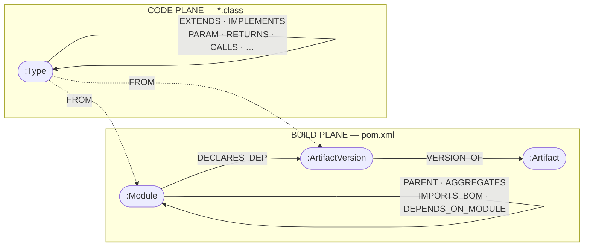

# dep-graph

Analyses a multi-module Maven project two ways at once.

- **Build plane** — what the poms declare. Modules, artifacts, versions, the skew between
  them, and the BOM that would remove it.
- **Code plane** — what the bytecode actually uses. Types, methods, fields, and the calls
  between them, read with ASM.

Both land in one Neo4J graph joined by a single edge, from each type to the module or
artifact version it came from. That edge is the reason the tool exists: on its own the
build plane can say a module depends on Guava and the code plane can say a class calls
`ImmutableList.of`, but only together can either say that nothing in the module ever
touches Guava, or that a class is using a type the module never declared and is living on
somebody else's transitive.



## Documentation

| | |
|---|---|
| [`docs/ARCHITECTURE.md`](docs/ARCHITECTURE.md) | Design, both relationship taxonomies, the graph shape, open decisions |
| [`docs/ARCHITECTURE.md`](docs/ARCHITECTURE.md) — Appendix A | **User's guide** — building, running each part, and what to do when it fails |
| `docs/Architecture.docx` | A built artifact, for reading or annotating in Word. **Do not edit it** — edit the Markdown and run `scripts/build-docs` |

The Markdown is the source of truth. `scripts/build-docs` renders each Mermaid diagram to
an image and converts the whole document with pandoc, so the Word copy carries the
diagrams rather than eight blocks of unreadable source. It needs `pandoc` and
`mermaid-cli` (`npm i -g @mermaid-js/mermaid-cli`).

## Running it

Any Maven project — a single pom or a multi-module reactor. One argument.

```bash
mvn package -DskipTests                       # builds the runnable jar

scripts/depgraph ~/src/my-service             # human report
scripts/depgraph ~/src/my-service/pom.xml     # a pom works too
scripts/depgraph ~/src/my-service --bom       # pasteable <dependencyManagement>
scripts/depgraph ~/src/monorepo --json > deps.json
```

| Option | |
|---|---|
| `--local-repo <path>` | default `$M2_REPO`, else `~/.m2/repository` |
| `--offline` | never reach the network |
| `--build-plane-only` | poms only; skip the bytecode |
| `--bom` | print the proposed `<dependencyManagement>` |
| `--json` | machine-readable output |
| `--quiet` | no narration |

Narration goes to stderr and data to stdout, so the redirect above does what it looks
like. Exit codes: `0` scanned, `1` bad usage, `2` not a Maven project, `3` scan failed.

A directory with no poms in it is an **error**, never an empty success — a scan reporting
zero of everything is indistinguishable from a project with no dependencies, and you would
believe the second one.

A single-module project has nobody to disagree with about a version, so its conflict count
is always zero. What it gets instead is the hoist: every version it pins by hand, collected
into a block.

## Status

**Complete end to end**, with 157 tests. `dep-graph-core` reads poms, resolves effective
versions, maps how the poms point at each other, classifies conflicts, proposes a BOM, and
reads compiled bytecode into seventeen kinds of class-to-class edge. `dep-graph-backend`
writes all of it into Neo4J and serves 27 canned queries; `dep-graph-frontend` is the UI
you click them in.

On the Aero estate: 36 modules and 163 dependencies on one side; 35,727 classes into
203,751 relationships on the other. A full scan and graph write takes about 28 seconds.

**The `FROM` bridge is joined.** Every type is now connected to the module or artifact
version that supplied it, which is what makes the six queries under "Where the poms and
the bytecode disagree" possible at all.

Still not built: the OpenRewrite pom rewriter (§9.3.7).

## Modules

| Module | What it is |
|---|---|
| `dep-graph-core` | The analysis engine — poms, bytecode, conflicts, BOM proposal. Pure records and plain Java; no Spring, no HTTP, no Neo4J. |
| `dep-graph-backend` | Spring Boot REST API. Raw `neo4j-java-driver` and hand-written Cypher, the canned-query catalogue, and a read-only ad-hoc endpoint. |
| `dep-graph-frontend` | React 18 + Vite + Tailwind behind nginx. Dashboard, scan runner, query browser. Not a Maven module. |
| `scripts/depgraph` | The CLI. A shaded runnable jar — no Docker, no Neo4J, no backend. |
| `scripts/depgraph-stack` | Brings the three containers up in the right order. |

## The graph stack

```bash
cp .env.example .env          # set SCAN_ROOT to the tree you want to analyse
scripts/depgraph-stack up     # builds the jar, then starts neo4j + backend + frontend
```

| Surface | URL |
|---|---|
| UI | http://localhost:9093 |
| API + Swagger | http://localhost:9094/swagger-ui.html |
| Neo4J browser | http://localhost:7476 (bolt 7689) |
| Frontend dev server | http://localhost:3005 (`npm run dev`) |

Each part starts on its own — `docker compose up -d neo4j`, `... backend`, `... frontend`,
or `scripts/depgraph-stack api` for the graph and API without building the UI.

The backend image is **runtime-only**: it copies a jar built on the host. Every pom here
inherits `aero-parent`, which lives outside this repository and therefore outside any
build context rooted at it, so building in-image would mean shipping the whole estate to
the Docker daemon. `scripts/depgraph-stack` does the two steps in order.

### The canned queries

27 of them, in five groups, each carrying the question it answers in plain words and — where
it has one — the reason its answer might be wrong. The group that matters is **"Where the
poms and the bytecode disagree"**: declared but never used, used but never declared, blast
radius, what couples two modules. None of those can be answered by reading poms or bytecode
alone, which is the whole argument for putting both planes in one graph.

## Building

`aero-parent` and `aero-bom` decide the Java level, the plugin versions and every
third-party version. Install them first:

```bash
mvn -f ../platform/pom.xml install
mvn clean verify
```

## Two ideas worth knowing

### A version is not a property of a dependency

It is the outcome of an argument between the module, its parents and every BOM they
import, and this tool records **who won**.

That is why it reads poms through Maven's own `ModelBuilder` rather than parsing XML. In
any project worth analysing most `<dependency>` elements have no `<version>` at all, and
most of the ones that do say `${something.version}` — a property that may be defined
three poms up, or overridden in a profile, or shadowed by a BOM. The fixture estate has
two modules that both say `${guava.version}` and resolve to different versions, which is
exactly the conflict a text-reading tool reports as agreement.

It is also why `ALREADY_MANAGED` is an exclusion rather than a finding. When an imported
BOM already decides an artifact, adding a hand-pinned version that beats it is not a fix;
it is the mechanism by which an estate drifts apart one upgrade at a time.

### Bytecode has exactly one blind spot that matters

`static final int MAX = 10` is copied into every caller by javac and leaves **no reference
to the declaring class at all**. A module whose only use of another is a constant looks
unused.

That is not hand-waved: every such field is flagged, and the estate has **15,377** of them.
The number is reported so an "unused dependency" finding can be presented as a question
rather than a verdict. See `docs/ARCHITECTURE.md` §5.3 for the other three.

### Class relationships captured

Seventeen, in three tiers by how hard the two types are to separate:

| Tier | Relations |
|---|---|
| `STRUCTURE` | `EXTENDS` `IMPLEMENTS` `NESTED_IN` `PERMITS` `TYPE_BOUND` `ANNOTATED_BY` |
| `SIGNATURE` | `FIELD_TYPE` `PARAM` `RETURNS` `TYPE_ARGUMENT` `THROWS` |
| `BODY` | `INSTANTIATES` `CALLS` `READS_FIELD` `WRITES_FIELD` `CASTS_TO` `CATCHES` `REFERENCES` |

A type from a jar is read **surface-only** — structure and signature, no bodies. Nobody
refactors inside a dependency, and that one rule is why a 33,000-class scan takes seconds.

### Pom relationships captured

Four, because a `<dependency>` is the edge everyone thinks of and rarely the one that
decides anything:

| Relation | From | Note |
|---|---|---|
| `PARENT` | `<parent>` | Usually points **outside** the scan — every repo here inherits `aero-parent` |
| `AGGREGATES` | `<modules>` | What builds together, not what decides settings |
| `IMPORTS_BOM` | `scope=import` | The single most important edge for explaining a version |
| `DEPENDS_ON_MODULE` | a dependency resolving to another module in the scan | **Derived, not declared** — the answer changes with the scan root |

### Conflict severities

| | Meaning | In the proposal? |
|---|---|---|
| `UNIFORM` | One version everywhere | Only if some module hand-pins it — otherwise there is nothing to hoist |
| `SAFE` | Patch skew (`2.15.2` / `2.15.4`) | Yes, bumped to the highest in use |
| `REVIEW` | Minor skew (`2.15.4` / `2.17.0`) | Yes, flagged |
| `BLOCKED` | Major skew (`3.3.1` / `4.0.11`) | No. That is an API migration, not a version bump |
| `ALREADY_MANAGED` | An imported BOM owns it | No. Align the BOM import instead |

### Deliberate holds

A version a project stays on **on purpose** goes in `.depgraph-holds.yml` at the scan
root:

```yaml
holds:
  - artifact: org.apache.pulsar:pulsar-client
    version: 3.3.1
    reason: >-
      4.x changes the schema and subscription APIs. This is an API migration rather
      than a bump, so it gets scheduled rather than inherited.
    until: when the messaging layer moves off the 3.x subscription API
```

A held artifact is proposed at the held version and stops being reported as something to
fix. A hold with no `reason` is ignored on purpose: an unexplained hold is
indistinguishable from neglect, which is the thing holds exist to be distinguished from.

## What the first run against this estate found

Pointed at `aero/` — 33 poms, 146 dependencies, 68 artifacts — it found four real
conflicts, each a module hand-pinning a version over a BOM that already manages it:

```
com.fasterxml.jackson.core:jackson-databind   jackson-bom manages 2.21.4;
                                              constants/const-catalog-core pins 2.17.0
org.assertj:assertj-core                      assertj-bom manages 3.27.7;
                                              constants/const-catalog-core pins 3.25.3
org.apache.activemq:activemq-broker           activemq-bom manages 6.1.8; a fixture pins 5.18.3
org.apache.activemq:activemq-client           activemq-bom manages 6.1.8; a fixture pins 5.18.3
```

It also corrected a standing claim in the estate's own architecture review — that document
records "seven repositories, zero cross-references", and there are now seven
`DEPENDS_ON_MODULE` edges. The claim was true when written; the platform work changed it
and nothing had noticed.

It found nine poms it could not read, all scanner fixtures with deliberately dangling
parents, and eleven modules with no `target/classes`, and said so by name rather than
quietly reporting a smaller estate.

That run changed the design once: the first version excluded every BOM-managed artifact
with the same sentence and produced sixty rows, fifty-six of which meant "Spring Boot
manages this and every module agrees". An artifact a BOM owns cleanly is now reported
nowhere at all.
